  
  
  
  

## About

I'm a Level 5 Computer Science student at **IIT** and the **University of Westminster**, based in Colombo, Sri Lanka.
I like building apps end to end: the mobile screens people tap, the APIs behind them, and the tests that keep both honest.

- 📱 Mobile and API work on **Sarvodaya Connect**, a platform for village societies of the Sarvodaya Shramadana Movement
- 🧪 Writing unit and end-to-end tests so endpoints behave before the UI relies on them
- 🌿 Working in Jira and GitHub sprints: branch per task, pull request review, squash merge
- 📚 Currently deep in Spring Boot, relational database design, and Flutter

## Tech I use

  

## What I'm building

| Project | About | Stack |
| :-- | :-- | :-- |
| **Sarvodaya Connect** | A five-person team project: a digital system for village societies. I own the mobile officer flow and the API tests. | Flutter · Next.js · NestJS · PostgreSQL |
| **Products API** | OOP coursework: a REST API with a clean UML design. | Java · Spring Boot |
| **Database Systems** | Enhanced ER modelling and logical design coursework. | SQL · ERD |

## Live GitHub activity

  
  

  

  <picture>
    <source media="(prefers-color-scheme: dark)" srcset="https://raw.githubusercontent.com/mithujannnnnn/mithujannnnnn/output/github-contribution-grid-snake-dark.svg" />
    <source media="(prefers-color-scheme: light)" srcset="https://raw.githubusercontent.com/mithujannnnnn/mithujannnnnn/output/github-contribution-grid-snake.svg" />
    
  </picture>

Build it. Test it. Ship it.

